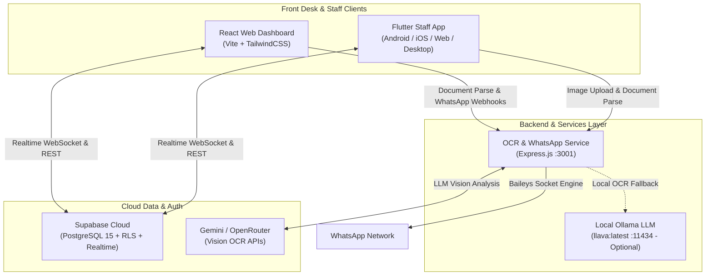

# EaseInn — Modern Offline-First Hotel & Property Management System (PMS)

[](LICENSE)
[](https://flutter.dev)
[](https://react.dev)
[](https://vitejs.dev)
[](https://supabase.com)
[](https://expressjs.com)

**EaseInn** is an offline-first, high-performance Property Management System (PMS) designed for boutique hotels, guest houses, lodges, and budget properties. It streamlines front-desk operations with sub-30-second check-ins, automated Indian government ID (Aadhaar/Passport/PAN) scanning via OCR, real-time multi-device cloud synchronization, automated WhatsApp messaging, and GST invoice generation.

---

## 🌟 Key Features

### 🛎️ Front-Desk Operations
- **Fast Check-in Flow:** Complete guest check-in in under 30 seconds with instant room assignment.
- **Room Grid & Housekeeping:** Real-time visual room matrix tracking room statuses (`Available`, `Occupied`, `Dirty`, `Cleaning`, `Maintenance`).
- **Billing & Folio Management:** Add extra charges, room service, manual adjustments, discount policies, and collect payments (Cash, UPI, Card).
- **Express Checkout:** Generate GST-compliant invoices and release rooms immediately.
- **Guest History & Registry:** Searchable guest directory with stay history, ID records, and contact details.
- **Shift & Expense Tracking:** Front-desk shift handovers, daily revenue totals, and expense logging.

### ⚡ Offline-First Architecture & Sync Engine
- **Instant Local Responsiveness:** Every check-in, status change, and payment applies immediately to the local UI store (`ChangeNotifierProvider` / `HotelStore`).
- **Durable Disk Outbox:** Offline mutations are queued in an append-only FIFO disk buffer (`OutboxQueueService`) that safely survives app crashes, device restarts, and connectivity drops.
- **Incremental Cursor Sync:** When network is restored, data pulls use `updated_at > last_sync_cursor`, slashing network payload sizes by over 98%.
- **Supabase Realtime:** Instant cross-device push notifications via WebSockets for real-time front-desk collaboration across multiple terminals and mobile devices.

### 🔍 Automated ID Scanner (OCR Engine)
- **Multi-Engine Pipeline:** Hybrid OCR utilizing Gemini Cloud Vision with fallback to local `Tesseract.js`.
- **Aadhaar Dual-Side Fusion:** Scans front (Name, Aadhaar Number, DOB, Gender) and back (Address, PIN code, Guardian/Care-Of) and fuses them into a structured guest record.
- **Pre-Processing Pipeline:** Image rotation, deskewing, and grayscale optimization powered by `Sharp`.

### 💬 WhatsApp Integration & Automated Messaging
- **Baileys Multi-Device Engine:** Built-in multi-tenant WhatsApp Web socket connection.
- **Instant Booking Confirmation:** Automated greeting message sent to the guest's WhatsApp upon check-in.
- **Digital Invoices:** Automated PDF tax invoices sent directly via WhatsApp at checkout.

---

## 🏗️ System Architecture



---

## 📁 Repository Structure

```text
Easeinn/
├── mobile/                 # Flutter mobile, tablet & desktop staff application
│   ├── lib/
│   │   ├── models/         # Hotel, Room, Guest, Booking, Expense data models
│   │   ├── screens/        # Dashboard, Check-in, Rooms, Guests, Expenses, Settings
│   │   ├── services/       # HotelStore, OutboxQueueService, LocalStoreService, SyncEngine
│   │   ├── theme/          # App design tokens, typography, and styling
│   │   └── widgets/        # Reusable UI components (RoomCard, GuestTile, etc.)
│   └── pubspec.yaml        # Flutter dependencies
│
├── frontend/               # React 19 + TypeScript + Vite management dashboard
│   ├── src/
│   │   ├── components/     # UI components and layout blocks
│   │   ├── context/        # HotelContext, AuthContext, ThemeContext
│   │   ├── pages/          # Dashboard, Rooms, Bookings, Guests, Analytics
│   │   └── lib/            # Supabase client and API utilities
│   ├── package.json        # Node dependencies & scripts
│   └── vite.config.ts      # Vite build configuration
│
├── ocr-server/             # Express.js OCR & WhatsApp microservice
│   ├── src/
│   │   ├── services/       # Cloud Vision OCR, Tesseract parser, WhatsApp Baileys engine
│   │   └── routes/         # OCR verification and WhatsApp messaging endpoints
│   ├── server.js           # Server entry point (Port 3001)
│   └── package.json        # Node dependencies & scripts
│
├── supabase/               # Database migrations & security rules
│   └── migrations/         # 00001 to 00012 SQL schema, RLS policies, RPC triggers
│
├── docs/                   # Product documentation, guides & audits
├── start-all.bat           # Windows 1-click startup (OCR Server + Frontend)
├── start-backend.bat       # Windows 1-click startup (OCR Server with local Baileys session)
├── ARCHITECTURE.md         # Deep-dive technical specifications & synchronization engine
└── DESIGN.md               # Visual design guidelines and component patterns
```

---

## 🚀 Quick Start Guide

### Prerequisites

Ensure you have the following installed on your machine:
- [Node.js](https://nodejs.org/) (v18.0 or later) & `npm`
- [Flutter SDK](https://docs.flutter.dev/get-started/install) (v3.24 or later)
- [Git](https://git-scm.com/)
- *(Optional)* [Ollama](https://ollama.ai/) if running local offline vision OCR models (`llava`).

---

### Method 1: One-Click Startup (Windows)

Use the pre-configured batch scripts to quickly start the backend and frontend:

1. Double-click or run [`start-all.bat`](file:///c:/Users/Piyush/OneDrive/Desktop/codes/extras/Easeinn/start-all.bat):
   ```cmd
   start-all.bat
   ```
   *This starts the OCR/WhatsApp server (port 3001) and the Frontend Web App (port 5173) in separate command windows.*

2. In a new terminal, launch the Flutter Mobile app:
   ```cmd
   cd mobile
   flutter run -d chrome
   ```
   *(Or target Android via `flutter run`)*

---

### Method 2: Manual Step-by-Step Setup

#### 1. Setup OCR & WhatsApp Server (`ocr-server/`)

```bash
cd ocr-server
npm install
```

Configure your environment variables:
```bash
cp .env.example .env
```

Edit [`.env`](file:///c:/Users/Piyush/OneDrive/Desktop/codes/extras/Easeinn/ocr-server/.env.example):
```env
PORT=3001
MAX_FILE_SIZE_MB=15

# Cloud Vision API Keys (Optional, provides high accuracy extraction)
GEMINI_API_KEY=your_gemini_api_key_here
OPENROUTER_API_KEY=your_openrouter_api_key_here
OPENROUTER_MODEL=google/gemini-2.5-flash

# Local Vision Model (Optional fallback)
OLLAMA_API_BASE_URL=http://localhost:11434
OLLAMA_MODEL=llava:latest
```

Start the OCR development server:
```bash
npm run dev
```
> The OCR server will start on [http://localhost:3001](http://localhost:3001).

---

#### 2. Setup Web PMS Dashboard (`frontend/`)

```bash
cd frontend
npm install
```

Configure environment variables:
```bash
cp .env.example .env.local
```

Edit [`.env.local`](file:///c:/Users/Piyush/OneDrive/Desktop/codes/extras/Easeinn/frontend/.env.example):
```env
VITE_SUPABASE_URL=https://your-project.supabase.co
VITE_SUPABASE_ANON_KEY=your-supabase-anon-key
VITE_OCR_SERVER_URL=http://localhost:3001
VITE_WHATSAPP_API_URL=http://localhost:3001
```

Start the Vite development server:
```bash
npm run dev
```
> The dashboard will be available at [http://localhost:5173](http://localhost:5173).

---

#### 3. Setup Mobile & Staff App (`mobile/`)

```bash
cd mobile
flutter pub get
```

Ensure Supabase client credentials in [`lib/services/supabase_service.dart`](file:///c:/Users/Piyush/OneDrive/Desktop/codes/extras/Easeinn/mobile/lib/services/supabase_service.dart) match your project configuration.

Run on your target environment:
```bash
# Check connected devices / emulators
flutter devices

# Run in Chrome browser
flutter run -d chrome

# Run on Android phone or emulator
flutter run -d android
```

---

## 🗄️ Database & Supabase Configuration

EaseInn utilizes PostgreSQL hosted via Supabase with Row Level Security (RLS) guaranteeing strict multi-tenant property isolation.

### Applying Migrations
Migrations are managed in [`supabase/migrations/`](file:///c:/Users/Piyush/OneDrive/Desktop/codes/extras/Easeinn/supabase/migrations):

```bash
# Using Supabase CLI:
supabase link --project-ref your-project-id
supabase db push
```

Key schema highlights:
- **`properties` & `managers`:** Multi-property structure with role-based access.
- **`rooms`:** Tracks real-time statuses (`available`, `occupied`, `dirty`, `cleaning`, `maintenance`) and pricing.
- **`guests`:** Guest details, Aadhaar/ID storage URLs, and contact info.
- **`bookings`:** Reservation state machine (`pending`, `checked_in`, `checked_out`, `cancelled`), timestamps, and folio balances.
- **`expenses`:** Hotel expense records categorized by vendor and shift.
- **RLS & Security Policies:** Ensures managers can only view and mutate entities belonging to their assigned properties.

---

## ⚙️ Service Ports & Endpoints

| Service | Directory | Default URL | Purpose |
| :--- | :--- | :--- | :--- |
| **Web Dashboard** | `frontend/` | `http://localhost:5173` | React/Vite admin dashboard |
| **OCR & Messaging API** | `ocr-server/` | `http://localhost:3001` | Aadhaar OCR, Baileys WhatsApp service |
| **Flutter Staff App** | `mobile/` | Custom / `localhost:auto` | Front-desk staff app (Android/iOS/Web) |
| **Ollama Service (Optional)** | System | `http://localhost:11434` | Local Vision model (`llava:latest`) |
| **Supabase Cloud** | Cloud | Project Endpoint | Auth, PostgreSQL Database, Realtime WebSockets |

---

## 🧪 Testing & Code Quality

### Mobile App (Flutter)
```bash
cd mobile
flutter analyze
flutter test
```

### Frontend (React)
```bash
cd frontend
npm run lint
npm run build
```

### OCR Backend
```bash
cd ocr-server
npm test
```

---

## 📖 Additional Documentation

For deep technical specifications, design system patterns, and audits:
- **[ARCHITECTURE.md](file:///c:/Users/Piyush/OneDrive/Desktop/codes/extras/Easeinn/ARCHITECTURE.md)** — In-depth architectural blueprint covering the offline sync engine, write outbox lifecycle, RLS policies, and OCR fusion logic.
- **[DESIGN.md](file:///c:/Users/Piyush/OneDrive/Desktop/codes/extras/Easeinn/DESIGN.md)** — UI design system specifications, color palettes, and component states.
- **[SYNC_PERSISTENCE_AUDIT.md](file:///c:/Users/Piyush/OneDrive/Desktop/codes/extras/Easeinn/SYNC_PERSISTENCE_AUDIT.md)** — Deep audit of offline storage resilience, reconciliation algorithms, and multi-device push mechanisms.

---

## 📄 License

This project is licensed under the MIT License — see the LICENSE file for details.
