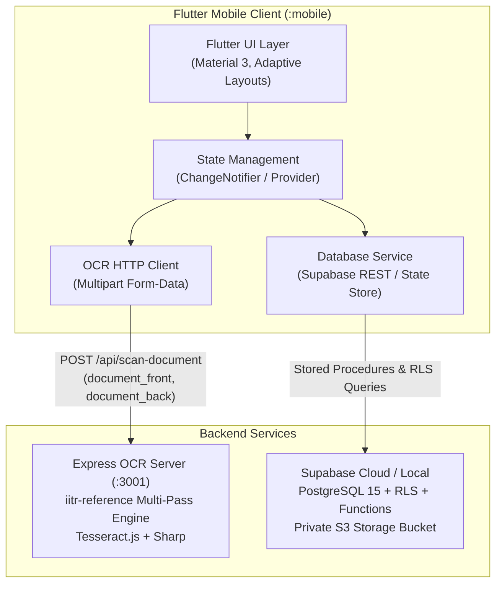

# EaseInn Mobile PMS — Architecture Document

**Version:** 2.0  
**Derived from:** [prd.md](file:///c:/Users/Piyush/OneDrive/Desktop/codes/extras/Easeinn/docs/prd.md), [UI Inspiration](file:///c:/Users/Piyush/OneDrive/Desktop/codes/extras/Easeinn/ui_inspo), [iitr-ocr-learnings.md](file:///c:/Users/Piyush/OneDrive/Desktop/codes/extras/Easeinn/docs/iitr-ocr-learnings.md)

---

## 1. System Architecture

---

## 2. Technology Stack

| Layer | Technology | Version | Rationale |
|---|---|---|---|
| **Mobile Framework** | Flutter | 3.35.4+ / Dart 3.9+ | Cross-platform (iOS, Android, Web/Desktop), native performance, responsive widget tree |
| **State Management** | Provider (`ChangeNotifier`) | 6.x | Reactive state management, dynamic updates across dashboard, rooms, and billing |
| **Networking & HTTP** | `http` package | 1.x | Robust multipart upload for dual-side document OCR and JSON APIs |
| **Typography & Icons** | `google_fonts`, Material Icons | Latest | Inter & Outfit typography, crisp icons matching UI inspiration |
| **OCR Backend** | Node.js Express Server | 4.x | Preserved `iitr-reference` Tesseract.js multi-variant engine |
| **Database** | PostgreSQL via Supabase | 15.x | Relational schema, RLS, transactional check-in/checkout stored procedures |

---

## 3. Data Integrity & State Invariants

1. **Calculated Metrics (No Mock Data)**:
   - `totalRooms = rooms.length`
   - `occupiedRooms = rooms.where((r) => r.status == 'occupied').length`
   - `vacantRooms = rooms.where((r) => r.status == 'vacant').length`
   - `cleaningRooms = rooms.where((r) => r.status == 'needs_cleaning').length`
   - `occupancyRate = totalRooms > 0 ? (occupiedRooms / totalRooms * 100) : 0%`
   - `activeGuests = activeStays.fold(0, (sum, s) => sum + s.numGuests)`
   - `todayCollection = payments.where((p) => p.recordedAt == today).fold(0, (sum, p) => sum + p.amount)`

2. **State Transitions**:
   - **Check-In**: Room `vacant` $\rightarrow$ `occupied`, Stay created (`active`), Bill generated, Advance recorded.
   - **Check-Out**: Room `occupied` $\rightarrow$ `needs_cleaning`, Stay status `checked_out`, Bill marked `finalized`.
   - **Housekeeping**: Room `needs_cleaning` $\rightarrow$ `vacant` (immediately re-enters available pool).

---

## 4. Mobile Screen Flow & Responsiveness

1. **Screen Safety**:
   - Every scrollable view wrapped in `SafeArea` and `SingleChildScrollView`.
   - Form inputs with proper keyboard dismiss and soft keyboard padding (`MediaQuery.of(context).viewInsets`).
   - Cards and rows use `Expanded`, `Flexible`, and text overflow ellipsis to guarantee **zero pixel overflow strips**.
2. **Key Screens**:
   - `LoginScreen`: Staff credentials with 1-tap demo login.
   - `DashboardScreen`: Live KPI counters, quick action tiles, and active stays list.
   - `RoomsScreen`: Floor 1 & 2 grid with status filters (Vacant, Occupied, Needs Cleaning, Reserved).
   - `CheckInScreen`: 3-step wizard with Dual-Side Aadhaar OCR upload zones, animated scan beam, and auto-filled form.
   - `CheckOutScreen`: Folio breakdown, payment settlement, and printable bill summary.
   - `GuestsScreen`: Searchable guest directory and profile dialog.
   - `HotelsScreen`: Multi-hotel branch switcher with "Add New Property" modal.
